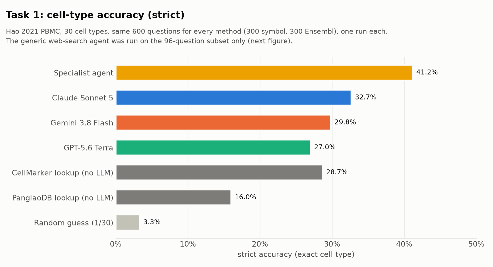
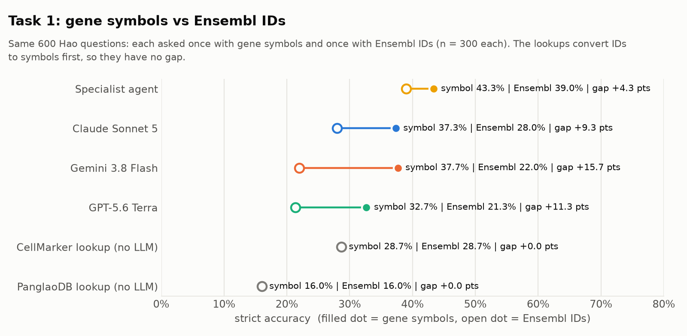
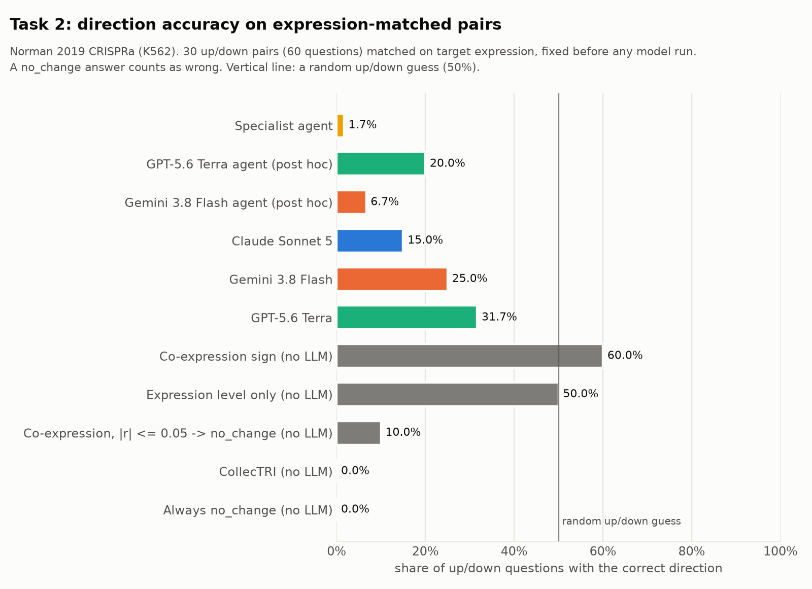
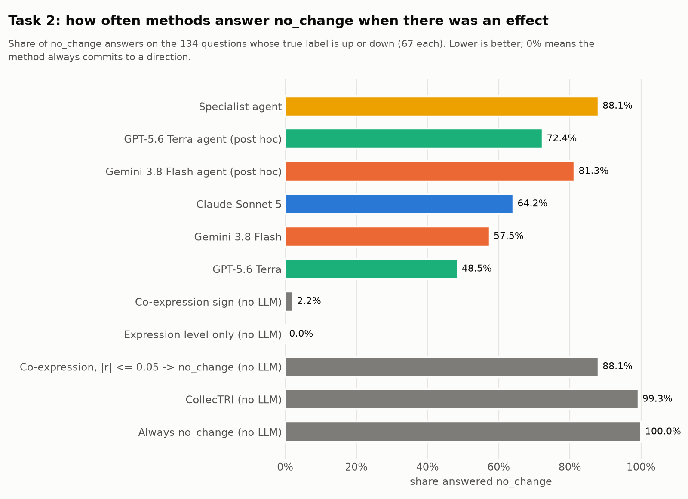
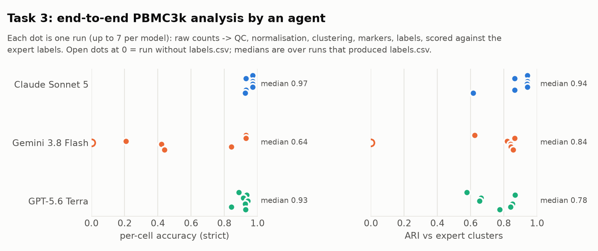
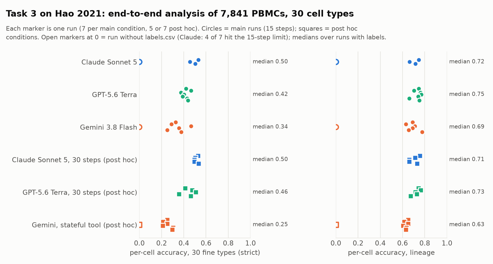

# llm-bio-bench

A benchmark of how well large language models handle three single-cell biology tasks, with and without
tools, compared against simple non-LLM baselines:

1. **Cell-type annotation** - name the cell type behind a list of marker genes (30 fine PBMC types, Hao et al. 2021).
2. **Perturbation direction** - after CRISPR activation of gene X, does gene Y go up, down or not change (Norman et al. 2019)?
3. **End-to-end analysis** - an agent gets raw count data in a sandbox and must produce per-cell labels itself.

Models: Claude Sonnet 5, GPT-5.6 Terra and Gemini 3.8 Flash, as plain models and as tool-using agents.
Every number below comes from [`methods.md`](methods.md), which documents each design and scoring decision,
including what was decided after seeing results.

## Key findings

1. Tools help with cell-type annotation. With a gene lookup and a marker database, Claude went from 32.7% to
   41.2% exact cell type on 600 questions (better on 58 questions, worse on 7; p = 4.3e-11). On a 96-question
   subset the same tools took GPT from 29.2% to 43.8% and Gemini from 30.2% to 38.5%.
2. Ensembl IDs are much harder than gene symbols for the plain models, which lose 9.3-15.7 points (Gemini
   drops from 37.7% to 22.0%). The Claude agent loses only 4.3 points. With Ensembl IDs, a simple marker
   lookup (28.7%) does about as well as plain Claude (28.0%).
3. Fine subtypes are still out of reach. On the six CD4 T-cell subtypes every method scores under 8%.
4. For perturbation direction, a simple baseline does better than any model. On 30 expression-matched
   up/down pairs the plain models get the direction right 15.0-31.7% of the time, while the sign of the two
   genes' co-expression in control cells gets 60.0%. When the models were given that co-expression as a tool,
   they mostly read weak correlations as "no change" (85-94% of the time) and got fewer directions right than
   without the tool.
5. As analysis agents, Claude and GPT labelled 95.3% and 91.1% of cells correctly on PBMC3k (8 types), the
   dataset of the standard scanpy tutorial. On Hao 2021 (30 types) the best runs got about 50%, mostly because
   CD8 T cells were labelled as CD4. A 30-step budget and, for Gemini, a Python session that keeps variables
   between calls did not change this, so these look like wrong biological calls rather than coding problems.
6. Re-running the LLM judge on 1,140 of its 1,290 decisions gave the same label 90.9% of the time (same
   lineage 97.4%). Headline scores moved by at most 1.5 points and no ranking changed.

## Repository layout

| Path | Contents |
|---|---|
| [`methods.md`](methods.md) | Full methods, every result table, decision log, disclosures |
| [`failures.md`](failures.md) | Annotated examples of wrong answers from the PBMC3k pilot |
| `src/` | All code: data preparation, question building, model and agent runs, judge, scoring, figures |
| `data/` | Question sets, label lists and answer keys (large raw files are git-ignored; see below) |
| `results/` | Every model answer (CSV, one row per question), agent trajectories, scores, judge cache |
| `results/figures/` | The figures shown here |
| `results/task3*/` | Task 3 runs: the agent's code, outputs and labels for every run, plus scores |

## Tasks and data

| Task | Question | Data | Size |
|---|---|---|---|
| 1. Cell-type annotation | "These are the top marker genes of a cluster from human PBMCs. What cell type is it?" | Hao et al. 2021 CITE-seq PBMC reference (CELLxGENE); PBMC3k pilot | 600 questions (30 types, gene symbols and Ensembl IDs, difficulty knobs) |
| 2. Perturbation direction | "In K562 cells, gene X is activated with CRISPRa. What happens to gene Y? up, down or no_change" | Norman et al. 2019 Perturb-seq (scPerturb) | 200 questions (67 up, 67 down, 66 no_change), 30 expression-matched pairs |
| 3. End-to-end analysis | Sandbox with raw counts only; do QC, clustering, markers and labels; save labels.csv | PBMC3k (8 types); Hao 2021 subset (7,841 cells, 30 types) | 7 runs per model per dataset |

- **Task 1:** questions vary marker rank (1-10 ... 31-40), number of genes (1-10), noise genes and a
  ribosomal/mitochondrial filter. Free-text answers are mapped to the 30 labels by exact rules, then a
  blinded LLM judge. "Strict" = exact type; "lenient" gives half credit for the right lineage.
- **Task 2:** labels come from pseudobulk differential expression; no_change targets are matched on
  expression level, and the matched pairs separate direction from expression level.
- **Task 3:** the agent has one `run_python` tool in a macOS sandbox: no network, no access outside its
  folder, 60 s per call, 15 calls, $1.50 per run. Scored per cell against expert labels and by ARI.

Baseline data: CellMarker (rows from Hao 2021 itself removed) and PanglaoDB for marker lookups; CollecTRI
for TF-target links.

## Conditions

| Condition | Task 1 | Task 2 | Task 3 |
|---|---|---|---|
| Plain LLMs (Claude via Anthropic API; GPT and Gemini via OpenRouter) | yes | yes | - |
| Non-LLM baselines: random, CellMarker / PanglaoDB lookup | yes | - | - |
| Non-LLM baselines: co-expression sign, expression level, CollecTRI, always no_change | - | yes | - |
| Generic agent: Claude + web search | 96-question subset | - | - |
| Specialist agent: Claude + MyGene.info + CellMarker | 96 subset and all 600 | - | - |
| Specialist agent: Claude + MyGene.info + co-expression + CollecTRI | - | yes | - |
| Specialist agent with GPT / Gemini (same tools and prompt) | 96 subset | yes (post hoc) | - |
| Sandboxed analysis agent (all three models, via OpenRouter) | - | - | yes |

Conditions marked **post hoc** were added after seeing earlier results and are reported separately.

## Results

### Task 1: cell-type annotation (Hao 2021, 600 questions, one run each)

| Method | Strict | Strict, symbols | Strict, Ensembl |
|---|---|---|---|
| Specialist agent (Claude + tools) | 41.2% | 43.3% | 39.0% |
| Claude Sonnet 5 | 32.7% | 37.3% | 28.0% |
| Gemini 3.8 Flash | 29.8% | 37.7% | 22.0% |
| GPT-5.6 Terra | 27.0% | 32.7% | 21.3% |
| CellMarker lookup (no LLM) | 28.7% | 28.7% | 28.7% |
| PanglaoDB lookup (no LLM) | 16.0% | 16.0% | 16.0% |
| Random guess | 3.3% | 3.3% | 3.3% |

96-question subset (one run each):

| Condition | Strict |
|---|---|
| Plain Claude / GPT / Gemini | 30.2% / 29.2% / 30.2% |
| Generic web agent (Claude) | 31.2% |
| Specialist agent: Claude / GPT / Gemini | 38.5% / 43.8% / 38.5% |
| Specialist + one-line nudge (Claude, post hoc) | 42.7% |

Each specialist agent vs its own plain model (paired): GPT 15 vs 1 discordant questions (p = 0.0005),
Gemini 11 vs 3 (p = 0.057). The agents do not differ significantly from each other (GPT vs Claude 8 vs 3,
p = 0.227).

PBMC3k pilot (8 broad types, 320 questions x 3 runs): Claude 78.6%, Gemini 72.6%, GPT 70.5%, CellMarker
lookup 64.4%, random 12.5%; the same Ensembl drop appears (Gemini 82.1% with symbols vs 63.1% with Ensembl IDs).




### Task 2: perturbation direction (Norman 2019, 200 questions, one run each)

| Method | Accuracy | Macro-F1 | Direction, all up/down | Direction, matched pairs | no_change on up/down |
|---|---|---|---|---|---|
| GPT-5.6 Terra | 46.0% | 0.430 | 29.9% | 31.7% | 49% |
| Gemini 3.8 Flash | 45.5% | 0.410 | 26.1% | 25.0% | 57% |
| Claude Sonnet 5 | 41.5% | 0.359 | 20.9% | 15.0% | 64% |
| Specialist agent (Claude + 3 tools) | 39.0% | 0.288 | 9.7% | 1.7% | 88% |
| Specialist agent (GPT + 3 tools, post hoc) | 43.5% | 0.370 | 18.7% | 20.0% | 72% |
| Specialist agent (Gemini + 3 tools, post hoc) | 39.5% | 0.312 | 11.9% | 6.7% | 81% |
| Expression level only (no LLM) | 49.0% | 0.391 | 73.1% | 50.0% | 0% |
| Co-expression sign (no LLM) | 42.0% | 0.345 | 61.9% | 60.0% | 2% |
| CollecTRI (no LLM) | 33.5% | 0.176 | 0.7% | 0.0% | 99% |
| Always no_change | 33.0% | 0.165 | 0.0% | 0.0% | 100% |

Agent vs its own plain model, direction on up/down (paired): Claude 4 vs 19 (p = 0.003), GPT 6 vs 21
(p = 0.006), Gemini 2 vs 21 (p = 6.6e-05). In 105 of the Claude agent's 122 wrong answers it read a weak
control-cell correlation (|r| <= 0.05) as "no effect"; for GPT it was 81 of 113, for Gemini 98 of 121.




### Task 3: end-to-end analysis

**PBMC3k** (8 types, 7 runs per model):

| Model | Runs with labels | Strict mean (SD) | ARI mean | Steps mean | Cost per run (est.) |
|---|---|---|---|---|---|
| Claude Sonnet 5 | 7/7 | 95.3% (2.3%) | 0.87 | 12.1 | $0.191 |
| GPT-5.6 Terra | 7/7 | 91.1% (3.5%) | 0.75 | 9.7 | $0.148 |
| Gemini 3.8 Flash | 6/7 | 53.9% (37.0%) | 0.81 | 15.0 | $0.077 |

The most common error was in clustering: CD8 T cells partly merged into a CD4-majority cluster (10 of 21
runs) or merged with NK cells into one cluster named NK (5 runs). Claude and Gemini kept exactly the scanpy
tutorial's 2,638 cells, which suggests they followed the tutorial from memory.



**Hao 2021** (7,841 cells, 30 types, 7 runs per model; accuracy over runs that saved labels):

| Model | Runs with labels | Strict (range) | Right lineage | ARI | Cost per run (est.) |
|---|---|---|---|---|---|
| Claude Sonnet 5 | 3/7 | 49.7% (45.6-53.1%) | 70.9% | 0.54 | $0.390 |
| GPT-5.6 Terra | 7/7 | 41.7% (37.5-46.6%) | 73.4% | 0.53 | $0.180 |
| Gemini 3.8 Flash | 6/7 | 34.5% (25.2-46.5%) | 69.3% | 0.47 | $0.090 |

Claude hit the 15-step limit without saving labels in 4 of 7 runs. The main error for every model was
T-cell subtypes: 55% (Claude), 60% (GPT) and 62% (Gemini) of CD8 T cells got CD4-lineage labels. No run
reused the PBMC3k tutorial's QC thresholds.

Post hoc follow-ups:
- **30-step cap (Claude and GPT, 5 runs each):** Claude finished all 5 runs (mean 22 steps, $0.734 per run)
  at 51.1% strict, about the same as before; GPT reached 44.3% and still used only 8-11 steps. The T-cell
  confusions stayed, so they come from the labelling decisions, not from running out of steps.
- **Stateful Python tool for Gemini (7 runs per dataset):** code errors fell (PBMC3k 26 -> 6, Hao 18 -> 0).
  Mean strict accuracy rose on PBMC3k (53.9% -> 72.5%) but fell on Hao (29.5% -> 21.8%).



### Scoring robustness

The LLM judge (Claude Sonnet 5, blind to the model and the true label) maps free-text answers to labels. It
agreed with a hand check on 27/30 answers and scores 40/41 on a fixed test set. An independent second pass
over 1,140 of its 1,290 decisions agreed on 90.9% of labels (97.4% on lineage). With the second-pass labels,
the headline Task 1 scores change by at most 1.5 points (Claude 32.7% -> 31.2%, specialist 41.2% -> 39.8%),
and the Task 3 Hao means by at most 0.3 points. No ranking or conclusion changes.

## Conclusion

The models know a fair amount about blood cell types. They name broad types from marker genes, and a gene
lookup plus a marker database improves them further (8.5 points for Claude on 600 questions, with similar
gains for GPT and Gemini on the 96-question subset). They do not get fine subtypes right: every method was
under 8% on CD4 T-cell subtypes.

Tools can also make things worse. For perturbation direction, all three models read weak co-expression as
"no effect" and got fewer directions right with the tool than without it. On direction, the co-expression
sign alone was more accurate than any model.

As analysis agents, the models almost exactly reproduce the well-known PBMC3k tutorial (about 95% for Claude)
but reach only about 50% on a 30-type dataset. Extra steps and a stateful Python session did not close that
gap, so the limit seems to be the biological decisions rather than the code.

Overall, the models are useful for routine annotation when given the right tools, but their answers, and the
way they interpret tool output, still need checking by someone who knows the biology.

## Limitations

- **One run per question** for Tasks 1 and 2 (the PBMC3k pilot used 3 runs and moved by at most 1.2 points
  between runs). Some comparisons have small n (96-question subset, 60 matched-pair questions, 5-7 Task 3 runs).
- **The judge is a Claude model scoring Claude and other models.** It never sees which model answered or
  the truth, and the second pass above bounds its effect, but it is not fully deterministic.
- **Possible training-data contamination:** Hao 2021, Norman 2019 and the PBMC3k tutorial are public.
  Hao-derived rows were removed from CellMarker; nothing can be removed from the models.
- **Task 2 labels depend on analysis choices** (fold-change definition, test, thresholds). Up targets are
  less expressed than down targets, which is why direction is also reported on expression-matched pairs.
- **One model per provider, one prompt, one cell line.** Agents got no instructions on how to read tool
  outputs; the nudge condition is the only exception and is post hoc.
- **Task 3 needs macOS** (`sandbox-exec`) and its costs are estimated from list prices.

## Future work

- **Gene pairs:** Norman 2019 has 131 two-gene activations whose single genes are also in the data -
  predict the combination from the singles, or detect genetic interactions.
- **Agents that are told what tool outputs mean** (e.g. that weak co-expression is not evidence of no effect),
  tested on fresh questions.
- A no-LLM reference pipeline for Task 3, repeat runs for Tasks 1 and 2, and more models per provider.

## How to reproduce

Python 3.14, packages in `requirements.txt`. API keys go in a `.env` file in the repo root (git-ignored):
`ANTHROPIC_API_KEY`, `OPENROUTER_API_KEY`. Run from the repo root:

```bash
python3 -m venv venv && source venv/bin/activate && pip install -r requirements.txt
```

**Task 1**

```bash
python src/prepare_data.py && python src/make_questions.py pbmc      # PBMC3k pilot (downloads itself)
# Hao 2021: save https://datasets.cellxgene.cziscience.com/4078abd1-063d-4b35-aa04-324dddf8244e.h5ad
#           as data/hao2021_pbmc.h5ad (2.6 GB, git-ignored)
python src/prepare_hao.py && python src/make_questions.py hao
python src/run_eval.py anthropic/claude-sonnet-5 --dataset hao --skip-knob noise
python src/run_eval.py openai/gpt-5.6-terra --dataset hao --skip-knob noise
python src/run_eval.py google/gemini-3.8-flash --provider openrouter --dataset hao --skip-knob noise
# marker databases into data/markers/: PanglaoDB_markers_27_Mar_2020.tsv.gz and human_cell_marker.txt
python src/baseline_marker_lookup.py hao cellmarker && python src/baseline_marker_lookup.py hao panglaodb
python src/agent_subset.py
python src/run_agent.py generic && python src/run_agent.py specialist && python src/run_agent.py specialist_nudge
python src/run_agent.py specialist --questions all_nonoise
python src/run_agent.py specialist --model openai/gpt-5.6-terra       # also google/gemini-3.8-flash
python src/judge.py && python src/score.py hao --skip-knob noise && python src/compare_baselines.py
python src/score_agents.py && python src/score_agents.py --all-nonoise
python src/judge_check.py && python src/judge_check.py --report      # second judge pass
```

**Task 2**

```bash
# Norman 2019: NormanWeissman2019_filtered.h5ad from Zenodo record 7041849 into data/norman2019/ (699 MB)
python src/inspect_norman.py && python src/task2_build.py && python src/task2_baselines.py
python src/run_eval.py anthropic/claude-sonnet-5 --dataset task2
python src/run_eval.py openai/gpt-5.6-terra --dataset task2
python src/run_eval.py google/gemini-3.8-flash --provider openrouter --dataset task2
python src/run_agent_task2.py                                        # --model openai/... for GPT / Gemini
python src/task2_score.py && python src/task2_agent_analysis.py
```

**Task 3** (macOS only: uses `sandbox-exec`; needs `OPENROUTER_API_KEY`)

```bash
python src/prepare_data.py                       # also writes the per-cell answer key data/pbmc3k_expert_cells.csv
python src/task3_agent.py --runs 7               # 7 runs per model; stops if the OpenRouter balance is below $3
python src/task3_score.py
python src/task3_hao_data.py                     # Hao input (data/task3_hao_raw_counts.h5ad) and answer key
python src/task3_agent.py --runs 7 --dataset hao && python src/task3_hao_score.py
# post hoc: --max-steps 30, or --stateful --models gemini; score with --dir results/task3_hao_30steps etc.
```

**Figures:** `python src/make_figures.py` writes `results/figures/`.

All runs are resumable (answers are saved as they come in) and `--test` flags ask one question without
saving. Seeds are fixed for every sampling step.

## Cost

API spend logged per answer in the results files (US$):

| Component | Cost |
|---|---|
| Task 1, PBMC3k pilot (3 models x 3 runs) | $10.74 |
| Task 1, Hao, plain models | $8.65 |
| Task 1, agents (generic, specialist incl. all 600, nudge) | $9.19 |
| Task 2, plain models | $1.80 |
| Task 2, specialist agent | $1.55 |
| Task 3, 21 agent runs (estimated at list prices) | $2.91 |
| Task 1, plain GPT and Gemini on the missing noise questions (for the 96-question comparison) | $0.24 |
| Task 1, specialist agent with GPT ($0.52) and Gemini ($0.47), 96 questions | $0.99 |
| Task 3 on Hao, 21 runs (estimated at list prices) | $4.63 |
| Post hoc A: Task 2 specialist agent with GPT ($1.09) and Gemini ($1.10) | $2.19 |
| Post hoc B: Task 3 Hao, 30-step cap, 10 runs | $4.52 |
| Post hoc C: stateful Gemini, PBMC3k ($0.38) and Hao ($0.51) | $0.89 |
| **Total logged** | **$48.31** |
| Judge check (second pass, 1,140 decisions; from the OpenRouter balance, not logged per call) | $5.63 |

Not included: first-pass LLM-judge calls, one-question tests, and runs discarded before cost logging was added.
